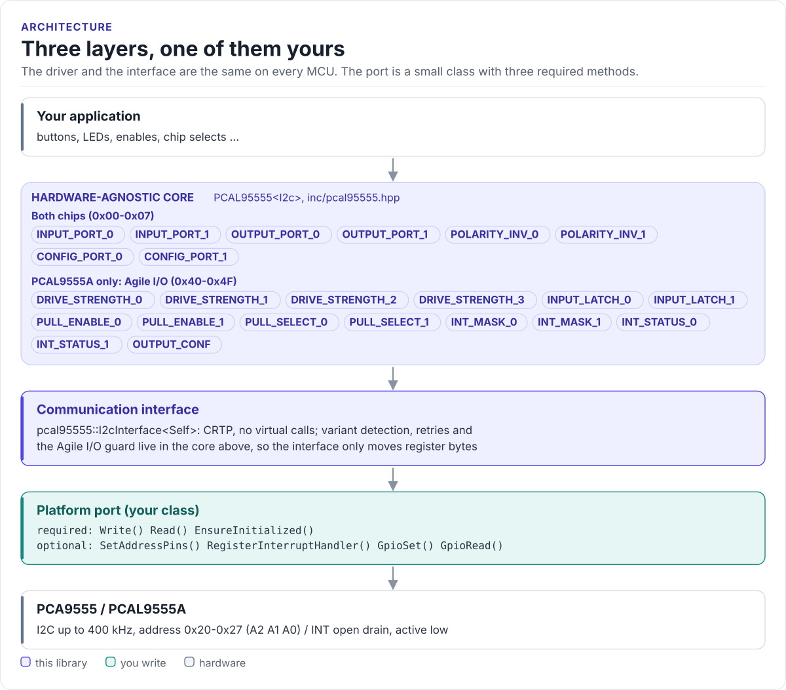

# PCA9555 / PCAL9555A Driver

A C++20 driver for the NXP PCA9555 and PCAL9555A 16-bit I2C I/O expanders: detect the part, drive and read sixteen
pins, and use the PCAL9555A's Agile I/O features, from any MCU with I2C.

[](https://github.com/hardfoc/hf-pcal95555-driver/actions/workflows/ci-host-tests.yml)
[](https://github.com/hardfoc/hf-pcal95555-driver/actions/workflows/esp32-examples-build-ci.yml)
[](https://hardfoc.github.io/hf-pcal95555-driver/)
[](LICENSE)

**Documentation: <https://hardfoc.github.io/hf-pcal95555-driver/>**

<!-- figure: driver-layers -->
<picture>
  <source media="(prefers-color-scheme: dark)" srcset="docs/diagrams/driver-layers.dark.svg">
  
</picture>
<!-- /figure -->

## In 30 seconds

Write a small port class for your MCU (register write, register read, bus init;
[Porting](https://hardfoc.github.io/hf-pcal95555-driver/latest/porting/)), then:

<!-- generated: quickstart-code -->
```cpp
#include "pcal95555.hpp"

int led_follows_button(MyI2c& bus) {
  pcal95555::PCAL95555<MyI2c> gpio(&bus, false, false, false);  // A2 A1 A0 low: 0x20

  if (!gpio.EnsureInitialized()) {                    // 1. probe, detect the variant
    return -1;                                        // wiring, pull-ups or address
  }

  gpio.SetPinDirection(0, GPIODir::Output);           // 2. P0_0 drives an LED
  gpio.SetPinDirection(8, GPIODir::Input);            //    P1_0 reads a button

  const bool pressed = !gpio.ReadPin(8);              // 3. button pulls the pin low
  if (!gpio.WritePin(0, pressed)) {                   // 4. LED on while pressed
    return -2;                                        // see GetErrorFlags()
  }
  return 0;
}
```
<!-- /generated -->

## What it does

- Detects a PCA9555 or a PCAL9555A at start-up (`GetChipVariant()`) and guards the Agile I/O calls on a PCA9555.
- Direction, output, input and polarity per pin, by mask or by list; pins 0-15 across both ports.
- PCAL9555A Agile I/O: pull-up / pull-down, four drive levels, input latch, interrupt mask and status, open drain
  per port.
- Per-pin interrupt callbacks on rising, falling or both edges, from the INT line or by polling.
- Address 0x20 to 0x27 from the A2-A0 levels, with run-time address changes on boards that drive those pins.
- No exceptions, no RTOS, no virtual calls (the port is a CRTP class).

## Install

```bash
git submodule add https://github.com/hardfoc/hf-pcal95555-driver.git external/hf-pcal95555-driver
```

```cmake
add_subdirectory(external/hf-pcal95555-driver)
target_link_libraries(my_app PRIVATE hf::pcal95555)
```

ESP-IDF: use the component wrapper in [`examples/esp32/components/hf_pcal95555`](examples/esp32/components/hf_pcal95555/CMakeLists.txt).
Details: [Installation](https://hardfoc.github.io/hf-pcal95555-driver/latest/installation/).

## Documentation

| | |
| --- | --- |
| [Quickstart](https://hardfoc.github.io/hf-pcal95555-driver/latest/quickstart/) | Wire it, write the port, light an LED |
| [Hardware](https://hardfoc.github.io/hf-pcal95555-driver/latest/hardware/) | Pins, addresses, bus timing, power |
| [PCA9555 and PCAL9555A](https://hardfoc.github.io/hf-pcal95555-driver/latest/variants/) | What each part has, register map, detection |
| [API guide](https://hardfoc.github.io/hf-pcal95555-driver/latest/api-guide/) | Configure, write, read, interrupts, errors |
| [Examples](https://hardfoc.github.io/hf-pcal95555-driver/latest/examples/) | ESP32-S3 test suite and LED demo |
| [API reference](https://hardfoc.github.io/hf-pcal95555-driver/latest/api/) | Doxygen, every class and member |

The pages are in [`docs/`](docs/index.md); the datasheets are in [`docs/datasheet/`](docs/datasheet/).

## Tests

```bash
cmake -S . -B build-host -DHF_PCAL95555_BUILD_TESTS=ON && cmake --build build-host && ctest --test-dir build-host
```

The host tests run the driver against a register model of both chips; the code on the documentation site is
compiled by the same build.

## License

GPL-3.0. See [LICENSE](LICENSE).
