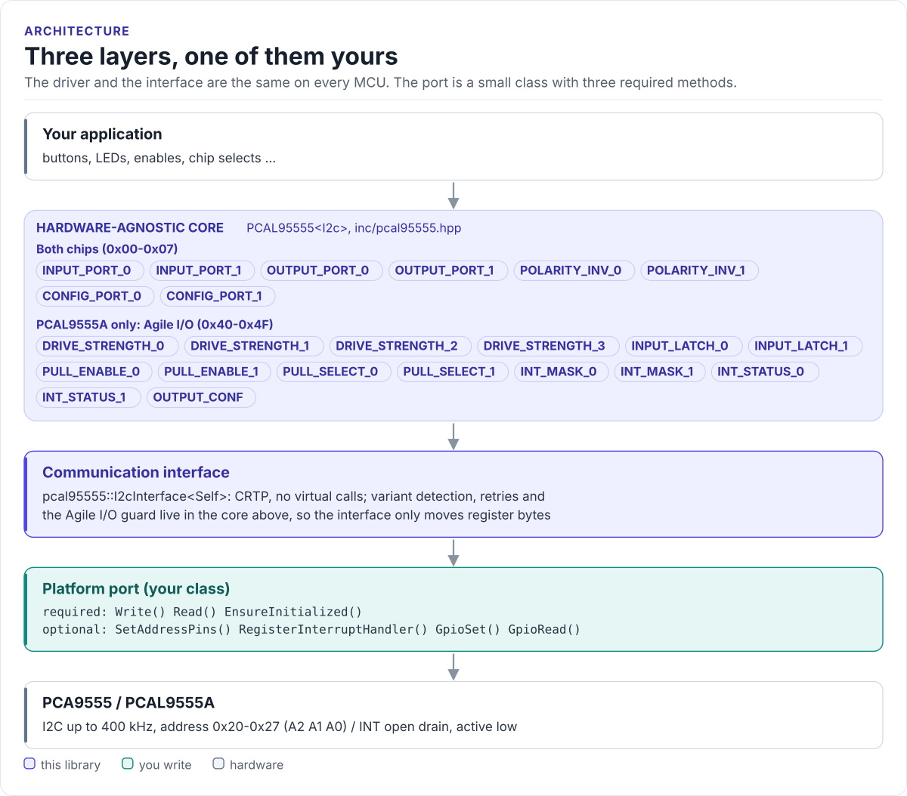
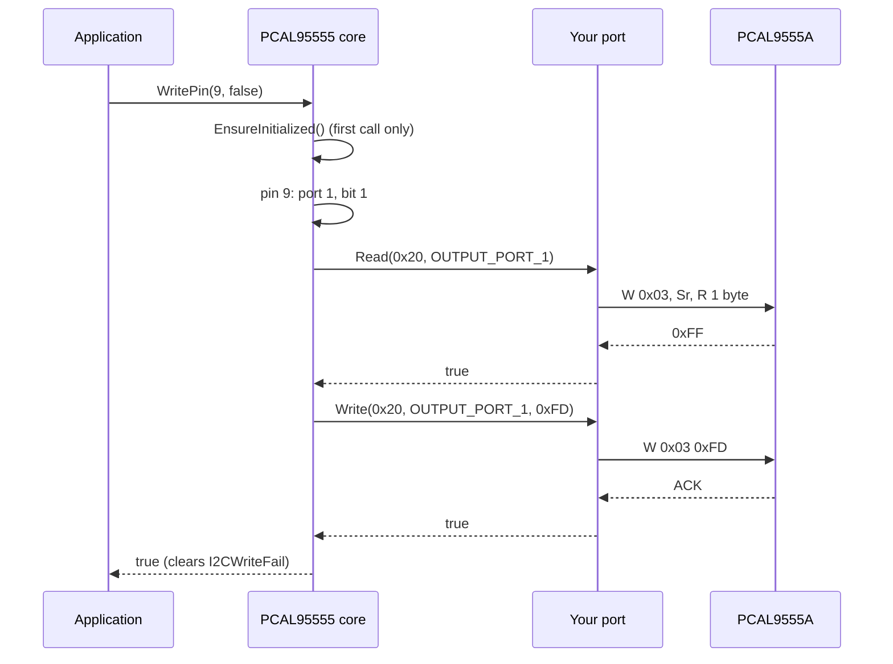

# Architecture

How the driver is put together: three layers, what each owns, and how one call reaches the chip.

<!-- figure: driver-layers -->
<picture>
  <source media="(prefers-color-scheme: dark)" srcset="diagrams/driver-layers.dark.svg">
  
</picture>
<!-- /figure -->

## The three layers

| Layer | Where | You change it when |
| --- | --- | --- |
| **Core**: `PCAL95555<I2c>` | [`pcal95555.hpp`](../inc/pcal95555.hpp), [`pcal95555.ipp`](../src/pcal95555.ipp) | Never, for a new board |
| **Interface**: `I2cInterface<Self>` | [`pcal95555_i2c_interface.hpp`](../inc/pcal95555_i2c_interface.hpp) | Never |
| **Port**: your class, over your SDK | Your project | Once per MCU or board ([Porting](porting.md)) |

The core depends only on the interface's methods, and the interface only on three methods of your port.
Everything above the port is the same on ESP32, STM32, a Linux host or the unit-test model. That is how the
[host tests](testing.md) run the real driver code without hardware.

## How one call reaches the chip

A failed transfer is retried `SetRetries()` times (once by default) before the call returns `false` and sets
`Error::I2CReadFail` or `Error::I2CWriteFail`.

## What happens at initialisation

Construction does no I/O. The first call that needs the chip, or your own `EnsureInitialized()`, runs:

1. `EnsureInitialized()` on your port: bring the bus up.
2. `SetAddressPins()` on your port, which may drive A2-A0 (the default does nothing).
3. A read of Input Port 0 at the address: if it fails, `I2CReadFail` is set and the call returns `false`.
4. Variant detection, unless the constructor fixed the variant: read Input Port 0, read Output Port
   Configuration (0x4F) without retries, read Input Port 0 again. An ACK at 0x4F means PCAL9555A; a NACK followed
   by a good read means PCA9555. See [PCA9555 and PCAL9555A](variants.md).
5. A snapshot of both input ports, the reference for edge detection.

## Why CRTP

The interface is a class template parameter, not a virtual base class. The compiler sees your port's methods
directly and inlines them; the driver has no vtable and needs no RTTI. The cost is that the driver type names the
port: `PCAL95555<MyI2c>`. Code that has to work with several port types takes the driver as a template parameter
too.

The optional methods (`SetAddressPins()`, `RegisterInterruptHandler()`, `GpioSet()`, `GpioRead()`) have bodies in
the base class. A port that declares a method with the same name hides the default; the driver always calls through
the port type, so the port's version is the one that runs.

## Design choices

- **Read-modify-write on single registers.** Single-pin calls read the port's register, change one bit and write
  it back: two transactions. Mask and list calls read both ports once and write each once.
- **One register per transaction.** No paired or auto-increment transfers, so any I2C controller that can do a
  register read can run the driver ([Hardware](hardware.md#bus-settings)).
- **Sticky error flags.** Calls return `bool`; the flags say why, and stay set until cleared or until a later
  success of the same kind clears its own flag.
- **Per-object transfer byte.** Every register transfer passes the bus a byte that lives in the driver object, not
  on the caller's stack, for MCUs whose I2C DMA cannot reach task stacks: place the driver object in DMA-capable
  RAM on such parts. Each object has its own byte, so drivers for different chips are independent
  (see [Porting](porting.md#threads)).

## Source map

| Path | Contents |
| --- | --- |
| `inc/pcal95555.hpp` | `PCAL95555<I2c>`, `Pcal95555Reg`, the pin and error enums, `PinReadResult`, `ChipVariant` |
| `src/pcal95555.ipp` | Template implementation, included by the header |
| `inc/pcal95555_i2c_interface.hpp` | `I2cInterface<Derived>`, `CtrlPin`, `GpioSignal` |
| `inc/pcal95555_kconfig.hpp` | Defaults of every `CONFIG_PCAL95555_*` macro used by `InitFromConfig()` |
| `inc/pcal95555_version.h.in` | Version header template, filled in by CMake |
| `Kconfig` | ESP-IDF menu for the start-up configuration |
| `tests/` | Host unit tests and the compiled documentation snippets |
| `examples/esp32/` | ESP-IDF applications for an ESP32-S3 |
