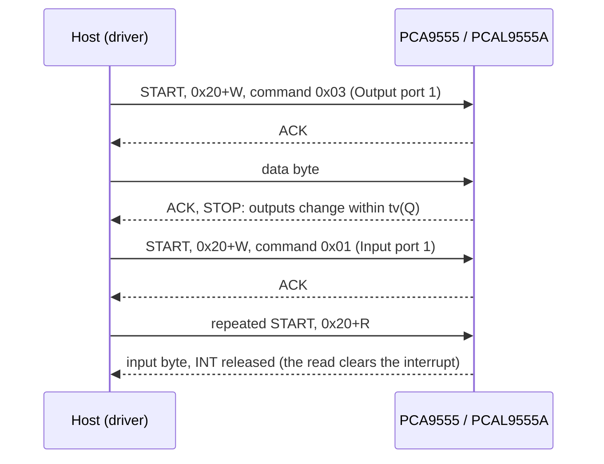

# Hardware

What to connect between your MCU and a PCA9555 or PCAL9555A, with which bus settings, and the limits that matter
to the host.

All values here come from the [PCAL9555A datasheet](datasheet/pcal9555a.pdf) (Rev. 2, December 2014) and the
[PCA9555 datasheet](datasheet/pca9555.pdf) (Rev. 10, November 2017). When they disagree with a board's schematic,
the schematic wins for pin numbers.

{ .hf-plate }

## Pins

The two parts are pin-compatible in the same package: a PCAL9555A drops into a PCA9555 footprint.

| Signal | TSSOP24 pin | HWQFN24 pin | Direction (chip) | Notes |
| --- | --- | --- | --- | --- |
| INT | 1 | 22 | out, open drain | Active low; pull it up to the MCU's I/O voltage |
| A1, A2 | 2, 3 | 23, 24 | in | Address bits; tie to VDD or VSS |
| P0_0 to P0_7 | 4 to 11 | 1 to 8 | in / out | Driver pins 0 to 7 (port 0) |
| VSS | 12 | 9 and exposed pad | power | Connect the pin, not only the pad |
| P1_0 to P1_7 | 13 to 20 | 10 to 17 | in / out | Driver pins 8 to 15 (port 1) |
| A0 | 21 | 18 | in | Address bit 0 |
| SCL | 22 | 19 | in | I2C clock |
| SDA | 23 | 20 | in / out, open drain | I2C data |
| VDD | 24 | 21 | power | Decouple with 100 nF close to the pin |

Neither part has a reset pin: only a power cycle below the power-on-reset threshold resets the registers.
`ResetToDefault()` writes the power-up values instead. The NXP datasheet of the PCA9555 names the port pins
IO0_0 to IO1_7; they are the same pins.

## Address

The 7-bit address is `0100 A2 A1 A0`: 0x20 to 0x27, up to eight expanders on one bus, in any mix of PCA9555 and
PCAL9555A.

| A2 | A1 | A0 | Address |
| --- | --- | --- | --- |
| 0 | 0 | 0 | `0x20` |
| 0 | 0 | 1 | `0x21` |
| 0 | 1 | 0 | `0x22` |
| 0 | 1 | 1 | `0x23` |
| 1 | 0 | 0 | `0x24` |
| 1 | 0 | 1 | `0x25` |
| 1 | 1 | 0 | `0x26` |
| 1 | 1 | 1 | `0x27` |

The driver takes either the three pin levels or the address. A board that drives A2-A0 from MCU GPIOs can move a
chip at run time with `ChangeAddress()`, through the port's optional `SetAddressPins()`.

## Bus settings

| Setting | Value |
| --- | --- |
| Bus | I2C / SMBus, 7-bit address |
| Clock | 0 to 400 kHz (Standard mode and Fast mode); no Fast-mode Plus |
| Register access | `[address+W] [command] [data]` to write; `[address+W] [command] Sr [address+R] [data]` to read |
| Register pairs | After each byte the command toggles between the two registers of a pair (port 0 / port 1) |
| Input levels (SCL, SDA, A0-A2, P ports) | VIH ≥ 0.7 × VDD, VIL ≤ 0.3 × VDD; inputs tolerate 5.5 V |
| Spike filter | 50 ns on SCL and SDA |

The driver sends one register per transaction, even for pairs: a two-byte paired write was seen to leave the
Configuration registers wrong behind one I2C controller. Your port therefore never needs more than a 2-byte write
(command and data) and a 1-byte read.

## Timing that affects the host

| Parameter | PCAL9555A | PCA9555 | Meaning |
| --- | --- | --- | --- |
| tv(Q) | 400 ns max | 200 ns max | Output valid after the ACK of the data byte |
| tv(INT) | 1 µs max | 4 µs max | INT asserted after an input changes |
| trst(INT) | 1 µs max | 4 µs max | INT released after the Input Port read |

INT goes active when an input differs from the Input Port register's last read value (on the PCAL9555A only for
unmasked pins) and goes inactive when that port is read, or when the input returns to its old level first (unless
it is latched). [Interrupts](interrupts.md) shows how the driver turns that into per-pin callbacks.

## Power and drive

| Quantity | PCAL9555A | PCA9555 |
| --- | --- | --- |
| VDD | 1.65 V to 5.5 V | 2.3 V to 5.5 V |
| Supply current, inputs, 400 kHz bus | 10 µA typ., 25 µA max (VDD 3.6 V to 5.5 V) | 135 µA typ., 200 µA max (5.5 V, 100 kHz) |
| Sink current per pin (recommended) | 25 mA max | 25 mA max (limit externally) |
| Source current per pin (recommended) | 10 mA max | VOH specified at 8 and 10 mA |
| Total through VSS | 200 mA max | 200 mA max (100 mA per port) |
| Internal pull | 100 kΩ typ. (50 to 150 kΩ), up or down, per pin, on by default (pull-up) | Weak pull-up (about 100 kΩ) on every input, always on |
| Operating temperature | -40 °C to +85 °C | -40 °C to +85 °C |

On the PCAL9555A the drive strength sets how much of the full output current a pin can sink or source:
`Level0` to `Level3` are 0.25, 0.5, 0.75 and 1 times full drive. Lower levels slow the edges and cut ground bounce
in low-capacitance loads; they are not a current limit for LEDs.

!!! warning "Set open drain before making pins outputs"
    The PCAL9555A datasheet recommends writing the Output port configuration register (0x4F) before the
    Configuration registers turn pins into outputs. Call `SetOutputMode()` before `SetPinDirection(pin,
    GPIODir::Output)` on a port that shares a line with other drivers. A PCA9555 has push-pull outputs only.

## Evaluation boards

The [ESP32 examples](examples.md) run on an ESP32-S3 board wired to a PCA9555 or PCAL9555A breakout: SDA on GPIO4,
SCL on GPIO5, INT on GPIO7 and A0 / A1 / A2 on GPIO45 / GPIO48 / GPIO47. The pin assignment lives in
[`esp32_pcal95555_test_config.hpp`](../examples/esp32/main/esp32_pcal95555_test_config.hpp).

## Reference documents

| Document | What it is for |
| --- | --- |
| [PCAL9555A datasheet](datasheet/pcal9555a.pdf) | Registers including Agile I/O, electrical limits, interrupt timing |
| [PCA9555 datasheet](datasheet/pca9555.pdf) | The standard register set, electrical limits, packages |
| [UM10204, I2C-bus specification](https://www.nxp.com/docs/en/user-guide/UM10204.pdf) | Bus timing and pull-up sizing |
