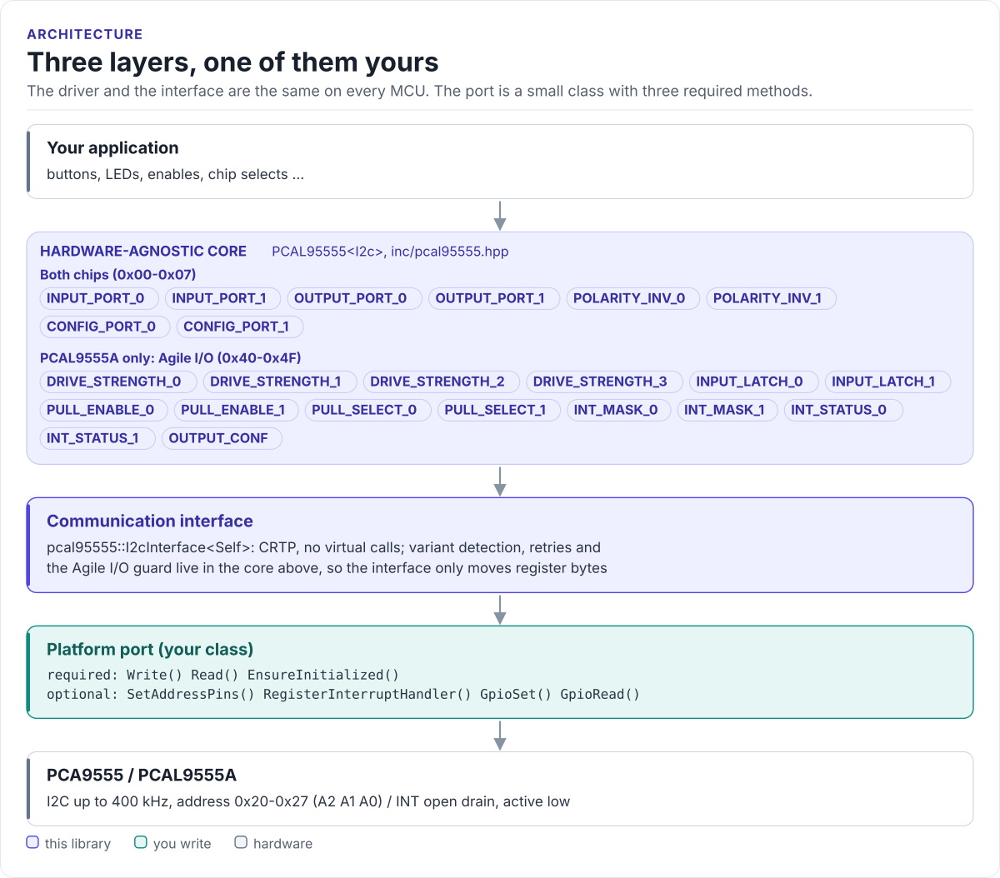

# Porting

Run the driver on a new MCU by writing one class: the I2C communication interface.

The driver never calls your SDK directly. It calls a few methods on a class you derive from
`pcal95555::I2cInterface<Self>` (in [`inc/pcal95555_i2c_interface.hpp`](../inc/pcal95555_i2c_interface.hpp)).
The base class uses CRTP: the calls are resolved at compile time, so there are no virtual functions and no vtable.

<!-- figure: driver-layers -->
<picture>
  <source media="(prefers-color-scheme: dark)" srcset="diagrams/driver-layers.dark.svg">
  
</picture>
<!-- /figure -->

## What you implement

| Method | Required | Contract |
| --- | :---: | --- |
| `EnsureInitialized()` | yes | Bring the bus up on the first call, return `true` at once afterwards. `false` stops initialisation with `I2CReadFail` |
| `Write(addr, reg, data, len)` | yes | One transaction: START, `addr` + W, `reg`, `len` data bytes, STOP. The driver always passes `len = 1`. Return `false` on a NACK or timeout |
| `Read(addr, reg, data, len)` | yes | Write `reg`, repeated START, read `len` bytes, STOP. The driver always passes `len = 1`. Return `false` on a NACK or timeout |
| `SetAddressPins(a0, a1, a2)` | no | Drive A0-A2 from MCU GPIOs, if the board wires them; the default returns `false` |
| `RegisterInterruptHandler(handler)` | no | Keep `handler` and run it from a task when INT falls; the default returns `false` |
| `GpioSet(pin, signal)`, `GpioRead(pin, signal)` | no | Control-pin hooks of the HardFOC interface model; this driver does not call them, since neither chip has a reset pin |

`addr` is the 7-bit address (0x20 to 0x27); your SDK may want it shifted left by one.

## The port

```cpp title="my_i2c.hpp"
--8<-- "tests/docs/my_i2c.hpp:port"
```

Rules the transfers must follow:

- **Return `false` for a NACK.** Variant detection depends on it: a PCA9555 NACKs command 0x4F, and a port that
  reports success anyway makes the driver believe it talks to a PCAL9555A.
- **Recover after a NACK.** The next transfer must work. Some controllers need a bus reset after a NACK; do it
  inside `Read()` / `Write()`.
- **Repeated START for reads.** The chips also accept a STOP between the command and the read, but a repeated start
  keeps another master from slipping in between.
- **Bounded time.** Use a timeout (a few milliseconds is plenty at 100 or 400 kHz); a stuck bus must not block
  forever.

## Interrupt support

`RegisterInterruptHandler()` receives a closure that calls the driver's `HandleInterrupt()`, which does I2C. Run it
from a task, not from the ISR: the usual pattern is an ISR on the INT pin's falling edge that wakes a task, which
calls the closure. Configure the MCU pin as an input with a pull-up (or rely on an external one); INT is open drain.

## Reference implementation

The ESP32 examples use [`esp32_pcal95555_bus.hpp`](../examples/esp32/main/esp32_pcal95555_bus.hpp): an ESP-IDF
`i2c_master` port at 400 kHz with internal pull-ups, GPIO-driven A0-A2 and an INT ISR that wakes a FreeRTOS task.
Start from it for any ESP-IDF target.

## Check your port

1. Build it: the port on this page is compiled by the host CI from [`tests/docs/`](../tests/docs/my_i2c.hpp), with
   the driver instantiated over it.
2. Call `EnsureInitialized()` and print `GetChipVariant()`: it must match the part marking.
3. Toggle an output with `TogglePin()` and watch it with a meter or a logic analyser.
4. Read `GetErrorFlags()` after a few hundred calls: it should stay 0 on a healthy bus.

## Threads

One driver object is not thread-safe: give each expander one owner task, or guard its calls with a mutex.
Driver objects share no state, so two expanders can be driven from two tasks without a common lock, as long as
your port's `Read()` / `Write()` serialise access to a shared bus. Callbacks run in the task that calls
`HandleInterrupt()`.
