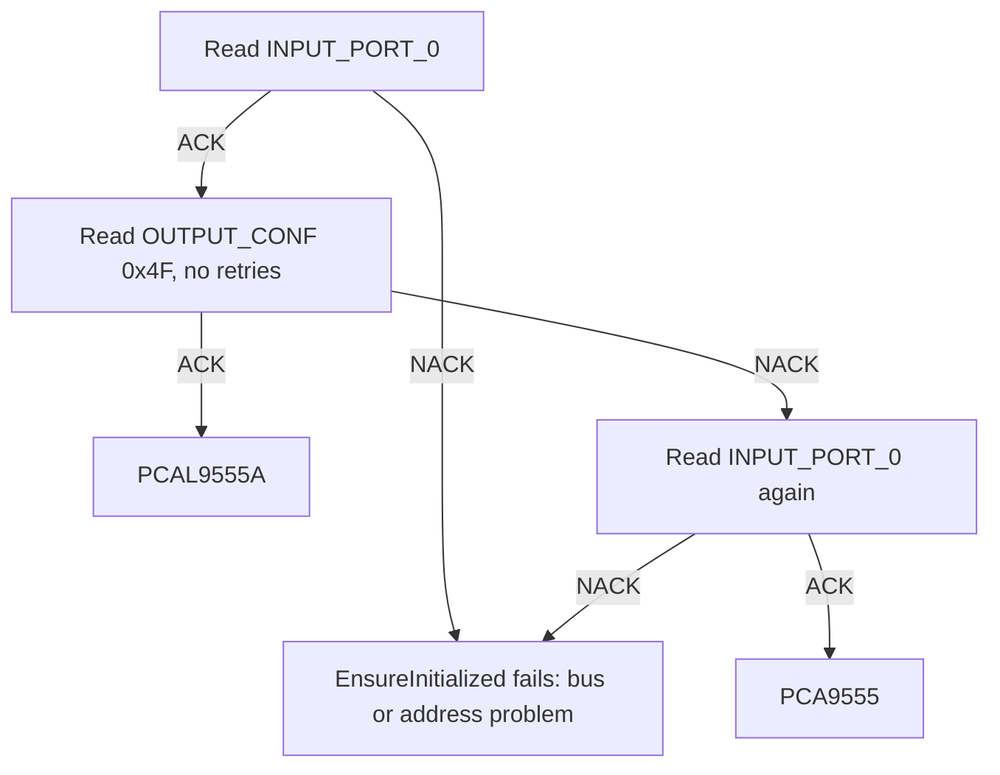

# PCA9555 and PCAL9555A

What the two parts have in common, what only the PCAL9555A adds, and how the driver tells them apart.

The PCAL9555A is a pin-to-pin and software-compatible successor of the PCA9555: it has the PCA9555's eight
registers at the same command bytes, and a second bank of Agile I/O registers at 0x40 to 0x4F. Code written for
the PCA9555 runs unchanged on a PCAL9555A. Two power-up differences matter: the PCAL9555A starts with every
interrupt masked, and with 100 kΩ pull-ups enabled.

## Features by part

| Feature | PCA9555 | PCAL9555A | Driver calls |
| --- | :---: | :---: | --- |
| Direction, output, input, polarity inversion | yes | yes | `SetPinDirection()`, `WritePin()`, `ReadPin()`, `SetPinPolarity()` and their mask / list forms |
| INT output on input change | yes, every input | yes, unmasked inputs | `HandleInterrupt()`, `RegisterPinInterrupt()` |
| Interrupt mask per pin | | yes | `ConfigureInterrupt()`, `ConfigureInterrupts()`, `ConfigureInterruptMask()` |
| Interrupt source register | | yes | `GetInterruptStatus()` |
| Pull-up or pull-down per pin (100 kΩ typ.) | fixed weak pull-up | yes | `SetPullEnable()`, `SetPullDirection()`, `GetPullConfiguration()` and list forms |
| Output drive strength, 4 levels per pin | | yes | `SetDriveStrength()`, `SetDriveStrengths()` |
| Input latch per pin | | yes | `EnableInputLatch()`, `EnableMultipleInputLatches()`, `EnableInputLatches()` |
| Push-pull or open drain per port | push-pull | yes | `SetOutputMode()` |
| Supply range | 2.3 V to 5.5 V | 1.65 V to 5.5 V | |

On a PCA9555 every call in the PCAL9555A-only rows returns `false` (or 0 for `GetInterruptStatus()`), sets
`Error::UnsupportedFeature` and sends nothing on the bus.

## Register map

<div class="hf-registers" markdown>

| Command | Register | Default | Part |
| --- | --- | --- | --- |
| `0x00`, `0x01` | `INPUT_PORT_0`, `INPUT_PORT_1` (read only) | pins | both |
| `0x02`, `0x03` | `OUTPUT_PORT_0`, `OUTPUT_PORT_1` | `0xFF` | both |
| `0x04`, `0x05` | `POLARITY_INV_0`, `POLARITY_INV_1` | `0x00` | both |
| `0x06`, `0x07` | `CONFIG_PORT_0`, `CONFIG_PORT_1` (1 = input) | `0xFF` | both |
| `0x40` to `0x43` | `DRIVE_STRENGTH_0` to `_3` | `0xFF` | PCAL9555A |
| `0x44`, `0x45` | `INPUT_LATCH_0`, `INPUT_LATCH_1` | `0x00` | PCAL9555A |
| `0x46`, `0x47` | `PULL_ENABLE_0`, `PULL_ENABLE_1` | `0xFF` | PCAL9555A |
| `0x48`, `0x49` | `PULL_SELECT_0`, `PULL_SELECT_1` (1 = pull-up) | `0xFF` | PCAL9555A |
| `0x4A`, `0x4B` | `INT_MASK_0`, `INT_MASK_1` (1 = masked) | `0xFF` | PCAL9555A |
| `0x4C`, `0x4D` | `INT_STATUS_0`, `INT_STATUS_1` (read only) | `0x00` | PCAL9555A |
| `0x4F` | `OUTPUT_CONF` (`ODEN1`, `ODEN0`) | `0x00` | PCAL9555A |

</div>

The names are the `Pcal95555Reg` enumerators. The drive-strength registers hold four pins each: `0x40` pins 0-3,
`0x41` pins 4-7, `0x42` pins 8-11, `0x43` pins 12-15, two bits per pin from bit 0 up (`00` = 0.25, `11` = full).

## How the driver detects the part



The detection relies on a PCA9555 not acknowledging command byte 0x4F. The PCA9555 datasheet defines only
commands 0x00 to 0x07 and does not say how the chip answers others, so treat the result as a well-tested
heuristic, not a guarantee. If your board fixes the part, pass the variant to the
constructor and the probe is skipped:

```cpp
--8<-- "tests/docs/configuration.cpp:variant"
```

!!! note "Inconclusive detection"
    When the second read of Input Port 0 also fails, the driver cannot tell the parts apart: `EnsureInitialized()`
    (and `ChangeAddress()`) return `false` with `I2CReadFail` set and the variant stays `Unknown`. The next call
    probes again. Fix the bus ([Troubleshooting](troubleshooting.md)) or pass the variant explicitly.

## Porting PCA9555 code to a PCAL9555A

- Interrupts: unmask the pins you want with `ConfigureInterrupt(pin, InterruptState::Enabled)`. A PCA9555 needs
  nothing; a PCAL9555A raises no interrupt until you do.
- Pull-ups: the PCAL9555A enables a 100 kΩ pull-up on every pin at power-up. Disable it (`SetPullEnable(pin,
  false)`) on pins with an external pull-down or an analogue load.
- Nothing else changes: same address range, same pins, same eight registers.

Next: [Interrupts](interrupts.md).
